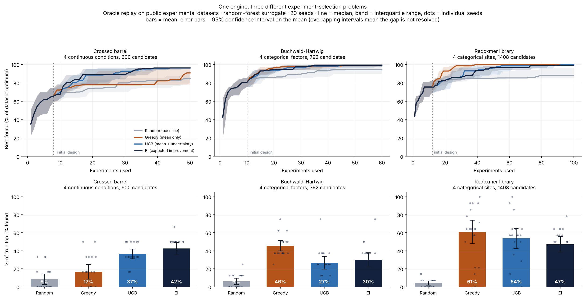

# Which experiment should we run next?

A small, reusable engine for comparing experiment-selection strategies under a
fixed experiment budget, benchmarked on three public experimental datasets with
very different structure.

Built after a four-day workshop on self-driving-lab (SDL) workflow design
(Korea Pharmaceutical and Bio-Pharma Manufacturers Association, taught by the
Acceleration Consortium at the University of Toronto, Sept 28 - Oct 1, 2026).
The workshop exercises used a simulated reaction surface; this repository
repeats the idea on real measured data and asks whether the conclusions hold.



## The question

Experiments cost time and reagents, so only a small fraction of a candidate
space can ever be measured. Given what has been measured so far, which candidate
should be measured next?

Four selection rules are implemented, but they are not four parallel
alternatives. They sit at three levels of information:

| Level | Information used | Rule |
|---|---|---|
| 0 | none | **Random** - the baseline |
| 1 | predicted value | **Greedy** - take the highest prediction |
| 2 | predicted value + uncertainty | **UCB** and **EI** - two acquisition functions |

UCB and EI are siblings: both score a candidate from the predicted value and the
uncertainty, and differ only in how they combine the two. UCB ranks by an
optimistic estimate, `mu + beta * sigma`. EI ranks by how much a candidate is
expected to beat the best value measured so far. Greedy is not an independent
idea either - it is exactly UCB with `beta = 0`.

They are still run as four separate arms, because "UCB and EI behave alike" is a
claim that has to be shown rather than assumed. It held, and more strongly than
expected: **UCB and EI could not be separated on any dataset**, at either
cutoff, while the gap from either of them to greedy was significant on two of
three. The levels, not the individual rules, are what the results separate.

## Method: oracle replay

Each dataset is a table in which every candidate has already been measured. The
engine hides the values and reveals one only when a strategy chooses to "run"
that candidate. This makes any problem reducible to a single candidate table, so
one engine runs all three, and it allows exact scoring against the true answer.

Each run: a random initial design, then refit the surrogate and pick one
candidate per step until the budget is spent. 20 random seeds per strategy.
The default surrogate is a random forest; uncertainty is the spread across its
100 trees. A Gaussian process is also implemented, and the two are compared
below.

Every strategy sees the same list of seeds, and for a given seed the initial
design is drawn **before the strategy is ever consulted**, so all four arms start
from an identical set of measurements. That makes the seeds matched pairs, which
is what the paired tests below rely on.

## How differences are tested

The first version of this README reported means only. That turned out to be
enough to state some conclusions that the data does not support, so every
comparison is now accompanied by a confidence interval and two paired tests
(`results/pairwise.csv`, produced by `sdl_engine/stats.py`).

Three things worth knowing before reading any number here:

- **Paired, not independent.** Comparing strategies across shared seeds removes
  the luck of the initial design from the comparison, the way weighing the same
  people before and after is better than weighing two different groups.
- **Read the interval, not the p-value.** If it contains zero, this benchmark
  cannot say which strategy is better. "Not distinguishable" is reported as
  exactly that, not as a small win.
- **The metric has a resolution limit.** Recall of the true top 1% can only take
  `n_top + 1` values, and the top 1% of 600 candidates is 6 rows - so on
  `crossed_barrel` recall moves in jumps of 16.7 points. Quoting a 5-point gap on
  that scale is reading a ruler past its markings. Top 5% is reported alongside
  for that reason, and on one comparison the two cutoffs genuinely disagree.

## Datasets

| Key | Problem | Shape | Candidates | Budget |
|---|---|---|---|---|
| `crossed_barrel` | toughness of a 3D-printed structure | 4 continuous conditions | 600 | 50 |
| `buchwald_a` | Buchwald-Hartwig C-N coupling yield | 4 categorical factors | 792 | 60 |
| `redoxmers` | redox flow battery molecule library | 4 categorical sites, 3 objectives | 1,408 | 100 |

Sources and licences are in [`datasets/SOURCES.md`](datasets/SOURCES.md).

## What the runs show

### 1. Every model-guided strategy beat random

Measured as the share of the true top 5% recovered within the budget, random
found 7-8% while the best model-guided strategy found 35-41%. **All nine
model-versus-random comparisons are significant at the top 5% cutoff**
(+15.5 to +33.7 points, every p < 0.001).

At the top 1% cutoff, eight of the nine hold. The exception is instructive:
greedy versus random on `crossed_barrel` is +8.3 points with an interval of
[-2.3, +18.9] and p = 0.12 - not resolvable. The top 1% there is 6 candidates,
so the metric cannot register a gap of half a step. The same comparison at top
5% is +15.5 points with p = 0.0004. The effect is real; the coarser metric just
cannot see it.

### 2. Whether exploration helps depends on the landscape - the ranking flipped

Share of the true top 1% found, mean of 20 seeds:

| Dataset | Random | Greedy | UCB | EI |
|---|---|---|---|---|
| `crossed_barrel` | 8% | 17% | 37% | **42%** |
| `buchwald_a` | 6% | **46%** | 27% | 30% |
| `redoxmers` | 4% | **61%** | 54% | 47% |

The flip is established by the first two rows, in both directions:

| Dataset | Comparison | Difference | 95% CI | p (paired t) |
|---|---|---|---|---|
| `crossed_barrel` | EI − greedy | +25.8 pp | [+16.2, +35.5] | 0.00002 |
| `crossed_barrel` | UCB − greedy | +20.0 pp | [+10.7, +29.3] | 0.0003 |
| `buchwald_a` | greedy − EI | +15.6 pp | [+6.0, +25.3] | 0.003 |
| `buchwald_a` | greedy − UCB | +18.8 pp | [+10.8, +26.7] | 0.0001 |

Both directions survive at the top 5% cutoff too (+15.3 and +12.0 points on
`crossed_barrel`; +6.1 and +7.5 on `buchwald_a`, all p < 0.02). So the central
claim of this repository rests on two datasets that disagree with each other
decisively.

**`redoxmers` does not add to that argument, and the earlier version of this
README wrongly implied it did.** Greedy's 61% leads UCB's 54% by 7.1 points with
an interval of [-5.2, +19.5], p = 0.24, and leads EI by 13.9 points with
[-1.0, +28.8], p = 0.065. Greedy's spread across seeds is 28 points. The dataset
is *consistent* with the exploitation story, but on its own it establishes
nothing beyond "all three beat random".

Checking the datasets explains the flip that is real. In `redoxmers` all 14 of
the true top candidates share the same substituent at site r1, and 9 of 14 share
one r3 group; in `buchwald_a`, 7 of the top 8 share one base. Good candidates sit
inside one family, so once the model locates that family, exploiting it harvests
the rest and exploration spends budget elsewhere. In `crossed_barrel` the top
candidates spread along a ridge - theta ranges over 25-200 and t over the full
0.7-1.4 - so exploration pays.

The practical reading: the exploration knob should be set from the structure of
the problem, not from a default.

### 3. UCB and EI could not be separated anywhere

Six comparisons (three datasets x two cutoffs), and not one of them resolves:
p ranges from 0.06 to 0.80, and every interval crosses zero. This is the
expected result for two members of the same family, and it is stated here as a
negative result rather than quietly reported as a 3-7 point win, which is what
the first version did.

### 4. A higher mean can come with worse reliability

On `redoxmers`, greedy's 61% carries a standard deviation of 28 points across
seeds, against 18 for EI - some greedy runs found almost everything and others
almost nothing. On `crossed_barrel` the opposite held: UCB and EI not only scored
higher but were steadier (standard deviation 1.2 and 1.7 on the final best value,
against 3.7 for greedy and 4.1 for random). Reporting only the mean would have
hidden both effects, which is why the figure shows every seed.

### 5. The surrogate test refuted its own prediction

The earlier limitations section argued that the random forest understates its own
ignorance away from the training data, and that this *penalises* UCB and EI; a
Gaussian process should therefore help them. The GP was run on `crossed_barrel`,
the continuous dataset where a GP is the natural choice, paired on the same 20
seeds. The result went the other way:

| Strategy | GP | RF | Difference | 95% CI | p (paired t) |
|---|---|---|---|---|---|
| random | 8.3% | 8.3% | 0.0 pp | [0.0, 0.0] | - |
| greedy | 21.7% | 16.7% | +5.0 pp | [-4.2, +14.2] | 0.27 |
| UCB | 30.0% | 36.7% | −6.7 pp | [-13.6, +0.2] | 0.057 |
| EI | 30.8% | 42.5% | **−11.7 pp** | [-18.4, -4.9] | 0.002 |

Switching to the better-calibrated model made EI significantly *worse*, nudged
UCB down, and nudged greedy up. The gap between exploitation and exploration
narrowed rather than widening. The honest conclusion is that the proposed
explanation for the RF's behaviour was wrong, and the mechanism is still open:
the forest's locally flat, disagreement-driven uncertainty appears to steer
exploration better on this surface than a smooth GP posterior does, which is not
what the calibration argument predicts.

Two things keep this from being a general claim: it is one dataset, and the GP
used the default Matern kernel with the noise level repeatedly converging to its
lower bound, which is a sign the kernel is not well matched to the data. What the
GP did improve is stability - EI's spread across seeds fell from 14.8 to 8.2
points - and with the GP, greedy's edge over random became resolvable
(+13.3 pp, p = 0.006) where it had not been with the forest.

The `random` arm scoring identically under both surrogates is worth noting: it
uses no model, so a difference there would have meant the two runs were not
actually paired. It is a check on the harness, not a finding.

## Limitations

These matter more than the numbers above, and they are the reason this is a
study of strategies rather than a claim about chemistry.

- **This is replay, not a closed loop.** Nothing was synthesised or measured.
  A real campaign has to deal with failed reactions, instrument drift, and batch
  effects, none of which appear here.
- **The candidate space is the table.** A real campaign can propose settings
  that were never measured; this one can only choose among existing rows. That
  makes the problem easier than reality.
- **20 seeds resolve large gaps only.** With the observed spreads, differences
  below roughly 10 points at top 1% are not detectable. Everything in that range
  is reported as not distinguishable, and `results/pairwise.csv` gives the
  interval for every pair. More seeds would narrow them; the ordering of levels
  is the durable result.
- **The recall metric is coarse at top 1%** - 6 to 14 candidates depending on
  the dataset. Top 5% is reported alongside for every comparison, and the two
  disagree once (greedy vs random on `crossed_barrel`).
- **The measurement noise in the source data sets a ceiling** that no strategy
  can pass. The datasets here do not carry replicate measurements, so that
  ceiling was not quantified - a gap worth closing.
- **The `redoxmers` weights are a human choice.** Three objectives were
  collapsed into one weighted sum with equal weights. Different weights define a
  different "top 1%" and could change the ranking. A sensitivity analysis is
  future work.
- **Each objective is normalised using the full table's min and max**, including
  rows the campaign has not measured. That defines the target, not the model's
  inputs, so it does not leak information into the search - but a campaign run
  on a genuinely unmeasured library could not define its objective this way.
- **The exploration knobs were never swept.** `beta = 2.0` and `xi = 0.01` are
  defaults. Since the headline conclusion is that these values should be set from
  the problem structure, not sweeping them is the most obvious missing experiment.
- **Why the GP changed the ranking is unexplained**, as described above.

## Using it on another problem

Add one `Dataset` to `sdl_engine/adapters.py`. Nothing else changes:

```python
def load_my_problem():
    df = pd.read_csv(DATA_DIR / "my_data.csv")
    return Dataset(
        key="my_problem",
        title="...",
        X=df[["param_a", "param_b"]].to_numpy(float),  # or _one_hot(df, [...])
        y=df["measured_value"].to_numpy(float),        # bigger must be better
        feature_names=["param_a", "param_b"],
        objective="maximise ...",
        source="citation",
    )
```

Register it in `REGISTRY`, add a budget in `scripts/run_all.py`, and run.

## Layout

```
sdl_engine/
  adapters.py    datasets -> (X, y). The only file a new problem touches.
  strategies.py  the four selection rules. The core of the repo.
  surrogate.py   random forest / Gaussian process, both returning (mu, sigma)
  campaign.py    the loop, and the recall metric
  stats.py       paired tests, confidence intervals, metric resolution
  plotting.py    figures
scripts/
  quickstart.py  ~20 s sanity check that the install works
  run_all.py     run one or all datasets, for one surrogate
  make_report.py merge results into the figure and tables
notebooks/
  01_walkthrough.ipynb   one campaign, step by step, including the paired tests
datasets/       the three CSVs, with sources and licences
results/        overview.png, summary.csv, pairwise.csv, surrogate_comparison.csv,
                run_config.json, and raw_<dataset>_<surrogate>.npz per run
```

Result filenames carry the surrogate, because a GP run and a forest run are
separate experiments - an earlier version let the second silently overwrite the
first.

## Reproducing

```bash
pip install -r requirements.txt

python scripts/quickstart.py          # ~20 s, checks the install works

python scripts/run_all.py --datasets crossed_barrel
python scripts/run_all.py --datasets buchwald_a
python scripts/run_all.py --datasets redoxmers
python scripts/make_report.py         # writes results/overview.png and the tables

python scripts/run_all.py --datasets crossed_barrel --surrogate gp
python scripts/make_report.py --surrogate gp   # also writes surrogate_comparison.csv
```

The forest runs take about 4-8 minutes per dataset on 2 CPU cores; the GP run on
`crossed_barrel` takes about 1.5 minutes. The figures and tables in `results/`
are already committed, so nothing has to be run to read the findings.

## Next

- Sweep `beta` and `xi` rather than fixing them, and check whether the
  per-dataset optimum matches the clustering analysis above. This is the
  experiment the main conclusion most directly asks for.
- Work out why the GP narrowed the exploration gap: fit the kernel properly,
  check the calibration of both surrogates directly, and run the GP on the other
  two datasets.
- Raise the seed count until the `redoxmers` comparisons resolve one way or the
  other, or report that the required count is impractical.
- Quantify the noise ceiling using datasets that include replicates.
- Add batch selection: real labs run several experiments in parallel, which
  changes the problem.
